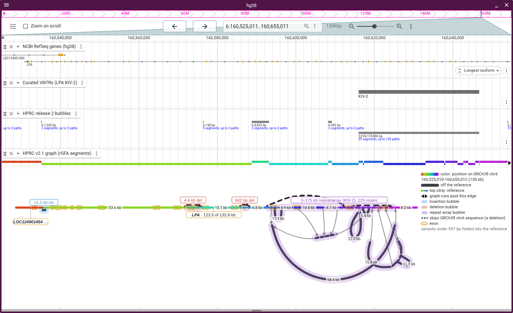
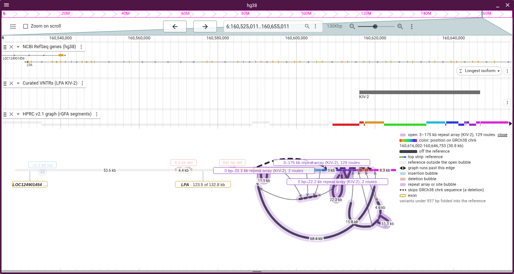

# Bubbles

- **Sources:** `<prefix>.bubbles.bed.gz` beside an rGFA index holds
  `gfatools bubble` records, and `gfa-to-tabix bubbles` writes the same file
  from a plain GFA's snarl VCF. A GBZ cut, a pggb file or an open bubble gets
  bubbles derived from the ordered layout
- **Show... › Show bubble halos** (off by default) draws each structural variant
  as a halo along its nodes, coloured by kind, named in the legend
- A variant under 50 bp is a tick above its nodes, named on hover
- Clicking a label opens the bubble in place: its nodes get the full colour
  ramp and the rest greys. Bubbles inside get labels, so a superbubble opens level
  by level. Click the label or the legend's **close** to shut it

The HPRC bubbles track draws the same records at their bp. The 3,018–174,966 bp
record, 29 segments and up to 129 paths, is the KIV-2 halo:

Opened, the KIV-2 array takes the whole ramp:

