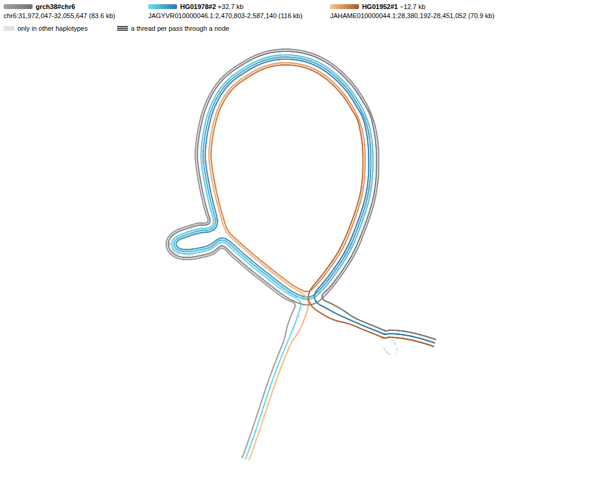

# Data and track config

The plugin reads a graph as tabix files or a gbz-base database, one window at a
time. A GFA small enough to load whole opens with **Add → Graph genome view**.

Build the graph with [minigraph](https://github.com/lh3/minigraph) (rGFA),
[pggb](https://github.com/pangenome/pggb) or
[Minigraph-Cactus](https://github.com/ComparativeGenomicsToolkit/cactus/blob/master/doc/pangenome.md)
(GFA and GBZ), then index it. [vg](https://github.com/vgteam/vg) 1.69.0 or later
covers the GBZ steps.

| Data                         | Commands                                                                                         | Adapter                                                          |
| ---------------------------- | ------------------------------------------------------------------------------------------------ | ---------------------------------------------------------------- |
| rGFA                         | `gfa-to-tabix build graph.rgfa.gz -o out` (0.11.0+)                                              | `RgfaTabixAdapter`                                               |
| Plain GFA (pggb, odgi, vg)   | the same, plus `--reference`, `--assembly`, `--snarls`                                           | `RgfaTabixAdapter`                                               |
| Alleles with a CIGAR each    | `build` writes `.alleles.bed.gz`; `gfa-to-tabix alleles <prefix>` from a `--layout contig` index | alignments track                                                 |
| Walks as tabix files         | `vg convert -f graph.gbz`, then `gfa-to-tabix --walks`                                           | `WalkTabixSyntenyAdapter`, or `RgfaTabixAdapter` with `walksUri` |
| Walks as one database        | `vg chains`, `gbz-base construct`, `gbz-haplotype-index`                                         | `GbzBaseSyntenyAdapter`                                          |
| Reads                        | `vg giraffe -o gaf`, `vg gamsort -G`, `bgzip`, `tabix`                                           | `reads` on a gbz-base adapter                                    |
| Minigraph paths per assembly | `minigraph -cxasm --call`, then `gfa-to-tabix paths` (0.9.0+)                                    | one row per bubble and sample                                    |

`gfa-to-tabix build` calls [gfatools](https://github.com/lh3/gfatools) for
bubbles and writes `.segs.bed.gz`, `.links.bed.gz`, `.bubbles.bed.gz`,
`.alleles.bed.gz`, a coarse tier, a `.graph.json` manifest and a track config.
For plain GFA, pass a VCF from `vg deconstruct -a` or `pggb -V`.

## syng graphs from impg

[impg](https://github.com/pangenome/impg) builds a
[syng](https://github.com/richarddurbin/syng) syncmer index with no alignment
step, and `impg query -o gfa:syng` cuts a region from it as a blunt GFA that
opens like any other.



[test_data/syng/build.sh](../test_data/syng/build.sh) builds this graph from
odgi's 90 C4 haplotypes, and
`npx -p @jbrowse/bandage-core bandage-figure test_data/syng/c4.json` draws it.
Three quirks of impg 0.5.0's output, which the script works around:

- impg puts a reverse-complemented haplotype on nodes of its own, splitting the
  graph in two, so orient the input to one strand
- impg leaves the query path out of the output, so query from a path you can
  spare
- Path names nest a range in a range (`chr6:31972046-32055647:0-83601`), and the
  walk keys read only the last one

The dashed loops off the backbone are variants. A syng branch repeats the
reference's sequence on both sides of a variant, so a SNP draws as a loop of
about 80 bp, where in a pggb graph it would be a 1 bp bubble.

## Opening tracks

- **File → Open track** opens an rGFA index (`.segs.bed.gz`), a walk file
  (`.walks.bed.gz`) or a gbz-base database (`.gbz.db`) as a `GraphTrack`. It
  finds the links and indexes beside the url, which a presigned url's signature
  does not cover, so spell out each location in a config for those
- **Add pangenome graph track** also reads `<prefix>.graph.json` for the coarse
  tier and the reference's PanSN sample. Without it the track has no coarse tier
- A walk file's name gives its reference sample: `chr22.GRCh38.walks.bed.gz`
  opened on `hg38` reads `hg38` as `GRCh38`. **Add pangenome graph track** also
  takes the haplotypes the track cuts for until you pick others

## Track config

```json
{
  "type": "GraphTrack",
  "trackId": "hprc_graph",
  "name": "HPRC release 2 graph",
  "assemblyNames": ["hg38"],
  "adapter": {
    "type": "RgfaTabixAdapter",
    "uri": "https://example.com/hprc",
    "coarse": {
      "uri": "https://example.com/hprc.fold10000",
      "foldBelowBp": 10000
    }
  }
}
```

- The track cuts the window plus a window each side, up to 5 Mb. Past
  `aboveBpPerPx` (default `foldBelowBp / 10`) it uses the `coarse` tier
  (`gfa-to-tabix fold`)
- Past the cut (5 Mb, or a gbz-base `nodeLimit`) the track asks you to zoom in.
  For a wide window, add the graph's VCF as a variant track
- **gbz-base:** `{ "type": "GbzBaseSyntenyAdapter", "uri": "….gbz.db" }`. An
  `hg38` or `hs1` track finds the GRCh38 or CHM13 reference sample, and
  `assemblyNameToPanSN` covers other names. A haplotype's lane draws on the
  assembly aliased by its PanSN name (`HG002#1`) with no map entry
- **Walk files:**
  `{ "type": "WalkTabixSyntenyAdapter", "walksUri": "….GRCh38", "assemblyNames": ["hg38"] }`
  draws the same haplotype lanes with no database
- The track menu picks layout, colour and highlighted haplotypes, and switches
  to the segments lane or, for gbz-base and walk-indexed graphs, the haplotype
  lanes
