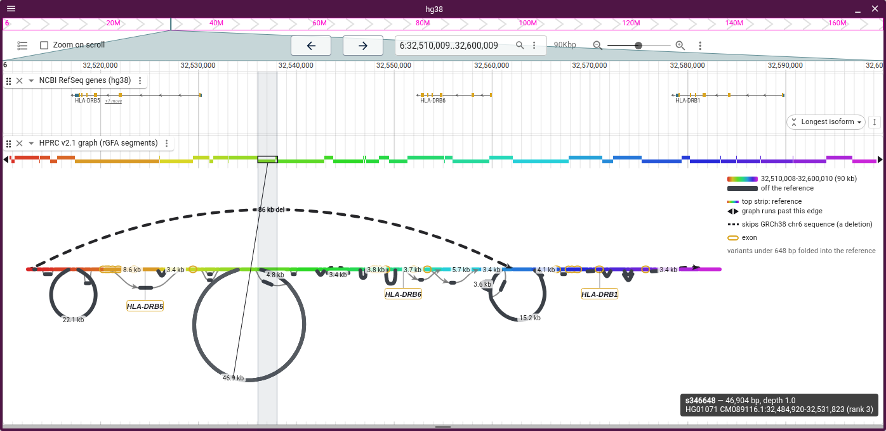

# Genes

The view draws each of the session's exons as a goldenrod outline around the
stretch of node it sits on, and pins the gene's name under its midpoint.

- The view draws exons on the backbone's nodes and on a coarse tier's bubble
  nodes
- A name never covers a node its gene is not on, so it moves a row or is left
  off
- The label of a gene partly in the cut gives how much of it the cut holds:
  `LPA · 35 of 132.8 kb`
- A tube map in a graph genome view draws genes in rows above the tubes. In a
  linear view the gene track shows them
- Where the linear view shows genes as a lane, the graph names only what the
  lane draws
- Records spanning a whole sequence (RefSeq's `region`) and records with no
  `gene_name`, `Name`, `gene` or `gene_id` get no name

In MHC class II, HLA-DRB5, HLA-DRB6 and HLA-DRB1 sit over their exons. Hovering
HG01071's 46.9 kb allele shows it replaces 173 bp of GRCh38 between HLA-DRB5 and
HLA-DRB6:

## Which assembly

A backbone names a sample by PanSN (`GRCh38#0#chr6`), not an assembly. The view
draws genes on a backbone only for the assembly it read them for.

- A walk names the cut's assembly when its sample or haplotype is the assembly's
  name, a session alias, a prefix that `assemblyNameToPanSN` maps, or a
  reference's well-known sample (hg38 is GRCh38, hs1 is CHM13)
- A path graph draws x along the first walk, which for gbz-base is the adapter's
  `referenceSample`, the database's only reference sample, or vg's `_gbwt_ref`.
  The track config puts that walk on the cut's assembly, whatever its name
- After "Draw x along" picks another walk, genes stay only where that walk names
  their assembly
- A sample-level name (`HG002`) names no haplotype of a diploid, and a bare
  (`chr6`) or generic name names none
