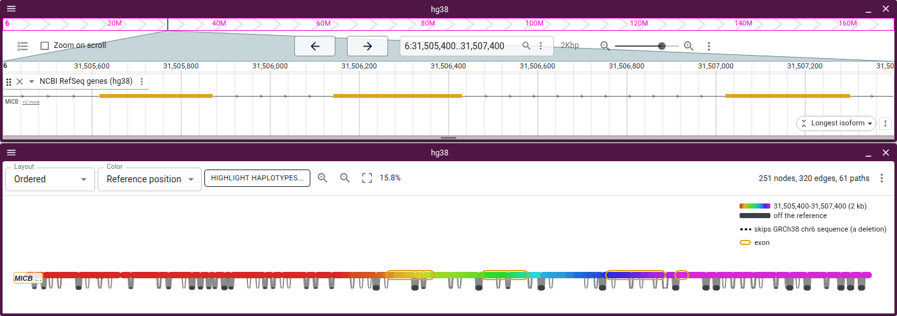
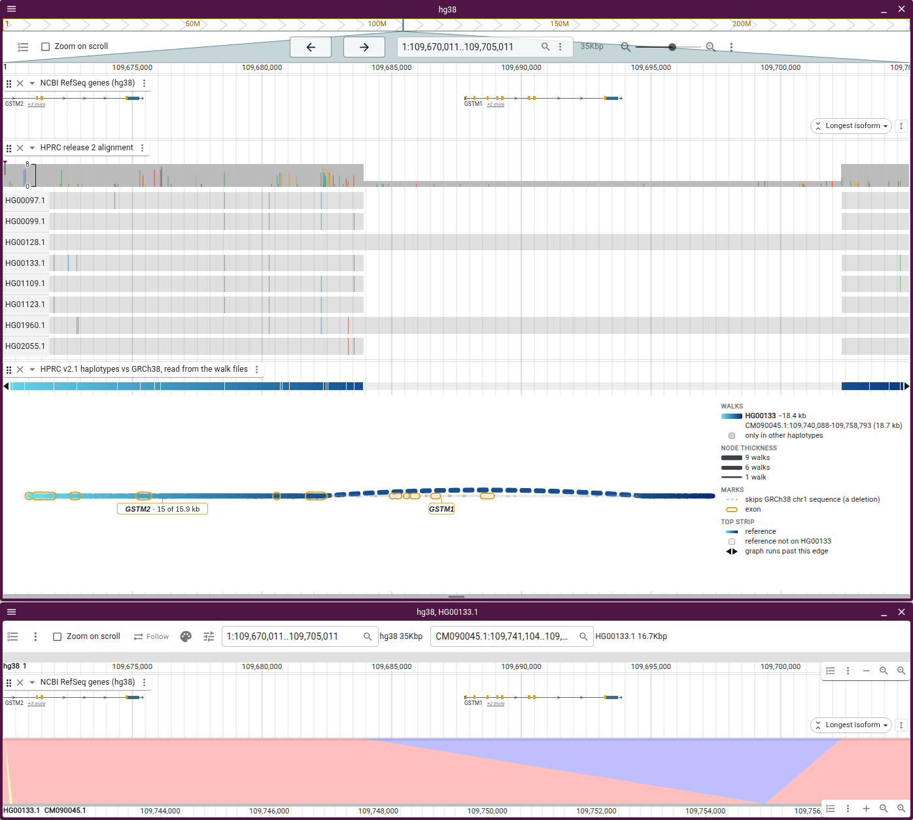
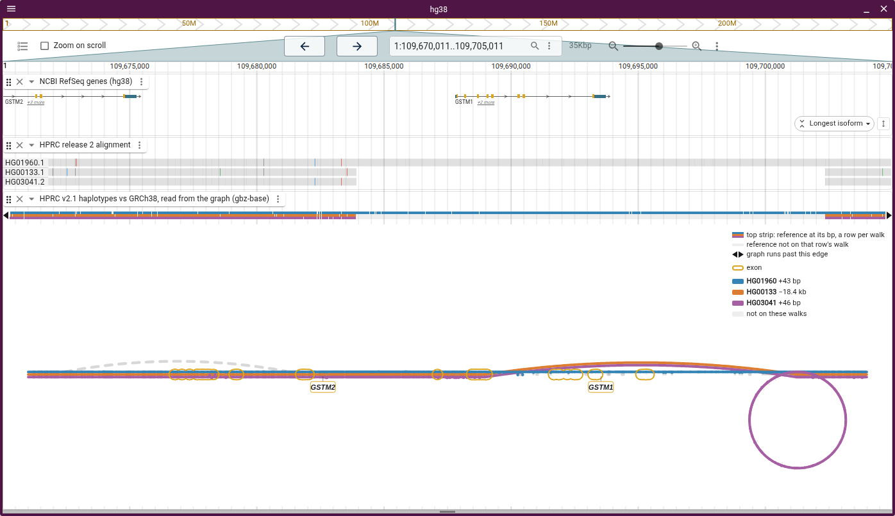
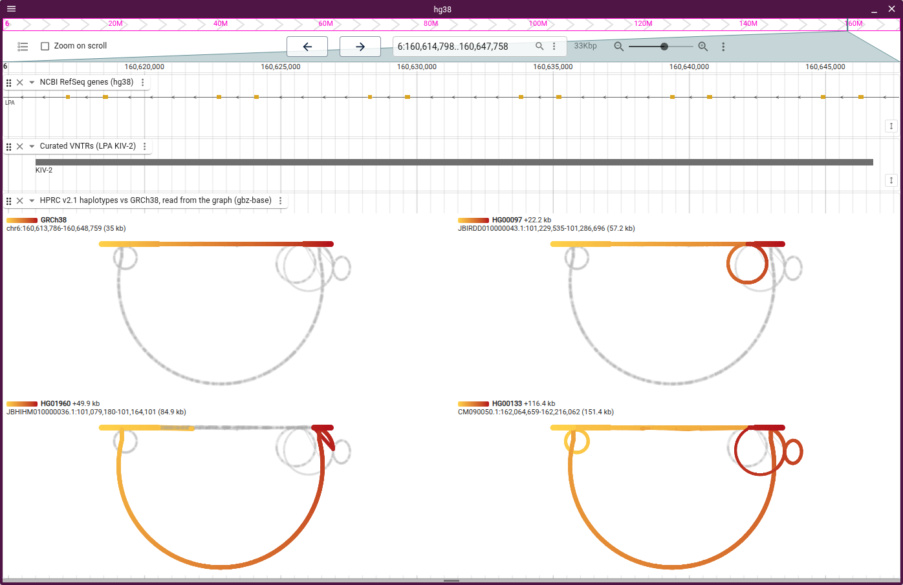
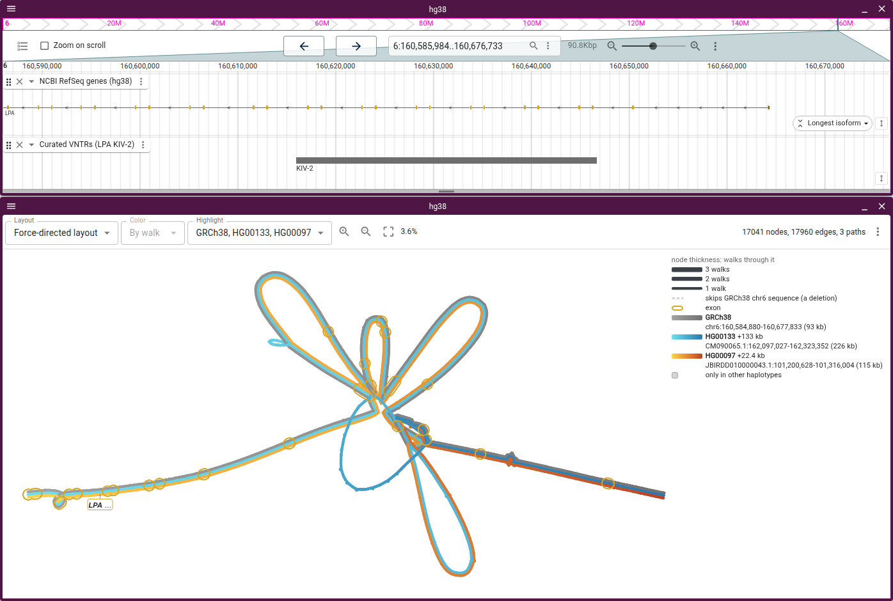
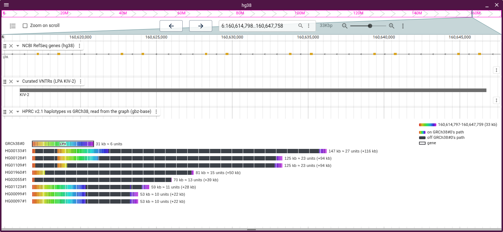

# Haplotypes

Walks come from a walk file, a gbz-base database or a GFA's W or P lines
([data.md](data.md)).

A node draws thicker the more walks visit it, and each route through a bubble is
labelled with its haplotypes and length. **Link width › By walks** in Graph
settings does the same for links, deletions included, so the common route
through a bubble reads heavy and a private one thin, without lifting any walk.

**Node width › By frequency** draws a node as wide as the share of haplotypes
through it, so the two settings together read as allele frequency. The Ordered
layout hangs each alternate allele below the reference, where its links stand
out.



## Lifting walks

The Highlight picker lifts walks out of the drawing, and the rest fades to grey.
Tube maps have no picker, since their tubes are the walks.

- Past a dozen walks, **Haplotypes** lists only lifted ones and **Choose
  haplotypes...** searches the rest
- A walk lifted alone shades light to dark along itself. Its key is a bar of
  that gradient with `contig:start-end (length)` under it
- Walks lifted together each take a flat colour and a lane, like a metro map.
  The reference is grey
- A walk that crosses the reference the other way runs the other way along it,
  so an inversion reads as red to yellow where the reference reads yellow to red
  (HG002's H2 haplotype at MAPT)

### Example: GSTM1

HG00133 lifted alone runs cyan to navy past the 18 kb its deletion skips:



Lifting three haplotypes together shows three routes:

- HG01960 runs through GRCh38's GSTM1
- HG00133 skips it
- HG03041 loops round a copy the graph never merged with GRCh38's. HPRC's wfmash
  alignment runs HG03041 straight through, so the loop reflects how the graph
  was built. 84 of 463 haplotypes have it

A panel per haplotype draws each route alone. HG00133's thread arcs over the
18.4 kb it skips, and HG03041's loop is its own copy:



## Facets

With two or more lifted, **Haplotypes › Arrange** facets the pane.

- **A panel per haplotype** draws the layout once per walk on a shared scale,
  yellow at the walk's start and red at its end. A panel's title is its key, and
  clicking it lifts that walk alone
- **A row per sample** puts a haplotype in each column, like
  `facet_grid(sample ~ haplotype)`
- Panels share one view, so a pan, zoom or hover in one applies to all. As many
  go across as draw each panel largest; `columns` fixes the count
- Hovering a node gives its position on each walk's contig in the key

Through KIV-2, HG00097 adds one loop to GRCh38's (+22.2 kb), HG01960 skips most
of GRCh38's for the big loop (+49.9 kb), and HG00133 takes both (+116.4 kb):



A session states walks and facet:

```json
"walkLayers": [
  { "walk": "GRCh38#0#chr6" },
  { "walk": "HG00133#1#CM090050.1", "color": { "scheme": "purple" } }
],
"facet": { "field": "walk", "sort": ["HG00133#1#CM090050.1"], "columns": 2 }
```

`sort` lists the walks or samples whose panels come first.

## Colouring lifted walks

**Haplotypes › Color highlighted...** sets a field and a scheme per walk.

| Field                   | Meaning                                               |
| ----------------------- | ----------------------------------------------------- |
| Progress along the walk | light at the start, dark at the end                   |
| One colour for the walk | which walk the lane is                                |
| Reference position      | where the node sits on the reference, charcoal off it |

Schemes run light to dark in distinct hues: grey to black for the reference,
then cyan to navy, yellow to red, pink to plum and lime to forest. The first two
stay apart for red-green colour blindness. The rainbow ramp is for reference
position only.

### Example: KIV-2 overlaid

With Progress along the walk on each lifted walk, the view shades each walk
light to dark along its own length in its own hue. Where a walk passes a node
more than once, the view draws a thread per pass:

- GRCh38 runs in along 30 kb of flank from either side to the array's loops
- HG00133 alone runs the loop at the lower left, and HG00133 and HG00097 run the
  loop at the lower right together
- **Bubble spread › Compress lengths** in Graph settings keeps HG00133's extra
  copies from dwarfing the rest, so read lengths off the key



The session lifts each walk with its field:

```json
"walkLayers": [
  { "walk": "GRCh38#0#chr6", "color": { "field": "progress" } },
  { "walk": "HG00133#2#CM090065.1", "color": { "field": "progress" } },
  { "walk": "HG00097#1#JBIRDD010000043.1", "color": { "field": "progress" } }
],
"bubbleSpread": "compress"
```

A lifted walk the walk file abridged loads in full, so its key states its whole
length. ggbandage's `kiv2_overlay` draws the same walks.

## Walk rows

Walk rows draw one bar per haplotype. Under the reference-position ramp:

- A stretch on the reference's path takes the hue of the reference stretch it
  runs through. A stretch off it is charcoal (blue and purple under other
  schemes)
- Charcoal is an alternative route through the graph, and may be sequence the
  reference has. In the HPRC amylase cut, HG00133#1 has three AMY1 copies, at
  GRCh38's length, yet 75 kb of its bar is purple. Count copies from the gene
  boxes instead
- The plugin boxes each bar's genes from the assembly named by its PanSN name
  (`HG00097#1`), reading that assembly's gene track over the bar's span on its
  own contig. A box is the haplotype's own annotation; the plugin lifts no
  GRCh38 gene across the graph. In the HPRC config every release 2 haplotype has
  one, with its CAT annotation, which names each copy of a duplicated gene after
  the GRCh38 copy it projected: HG00232#1's seven AMY1 copies read AMY1C five
  times
- A haplotype whose deletion, up to about 2 Mb, spans the whole window is a row
  of deletion, from the walk file's skip rows (gfa-to-tabix 1.5 and later, the
  HPRC `-f5s` files). A file without them gives that haplotype no row
- A walk file abridges a long walk through a satellite array. Walk rows read a
  list of up to 64 named haplotypes in full; under **Every haplotype** or a
  longer list, an abridged bar ends in gold dashes, and **Load the abridged
  steps** in its right-click menu reads it in full
- Right-click a bar to open its span in a linear view on that haplotype's
  assembly
- Node lengths are not labelled while walks are lifted
- **Ribbons between rows** joins each stretch of a bar to where the bar below
  walks the same nodes, lavender where it walks them backwards. A duplicated
  copy fans out to both copies below it, and an inversion crosses over
- **Letter shared blocks** boxes each stretch of nodes off the reference's path
  that two or more rows walk: A for the block with the most bp, then B and C in
  colour and the rest in grey. A row with A twice carries that copy twice
- **Order rows by shared sequence** stacks each row under the one it shares the
  most sequence with, so ribbons stay short and blocks line up. A grouping keeps
  this order within each section

The **Repeat** picker tiles bars by a repeat annotation's unit and marks the
allele a genotyper called. With the curated VNTR track, the picker tiles each
KIV-2 bar by the 5,548 bp kringle, about 6 copies in GRCh38 and 27 in HG00133:



In a tandem array the copy hue is the aligner's pick among near-identical
copies: at KIV-2, 13 of 32 threaded copies take the hue of a reference copy of
the other repeat type. To colour by the true unit, load
[jbrowse-plugin-tandem-repeat](https://github.com/GMOD/jbrowse-plugin-tandem-repeat)
and right-click a VCF 4.5 `<CNV:TR>` record.

## Haplotype lanes

A `WalkTabixSyntenyAdapter` track's lanes display stacks a lane per haplotype
under the reference, each in the haplotype's own coordinates.

- A haplotype whose deletion, up to about 2 Mb, spans the whole window still
  gets a lane, from the walk file's skip rows (gfa-to-tabix 1.5 and later, the
  HPRC `-f5s` files). The lane centres where the haplotype crosses the deletion,
  and the window's ribbon narrows to that position
- The adapter finds the crossing by reading the reference node where the
  haplotype leaves, so each such lane costs one more chunk read
- A haplotype that walks the window on another contig draws that contig instead
- A walk file without skip rows opens no lane for such a haplotype
