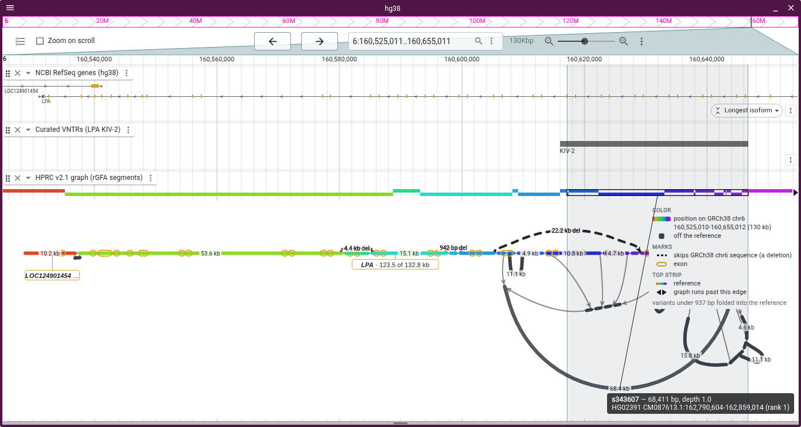

# Layouts

| Layout                | x axis                                       | Needs                        |
| --------------------- | -------------------------------------------- | ---------------------------- |
| Force-directed        | graph shape, seeded along the reference      | any graph                    |
| Ordered               | reference order, so a bubble reads as a lens | rGFA or reference path       |
| Anchored              | reference bp, a row per stable rank          | rGFA or reference path       |
| Sample rows           | reference bp, a row per assembly             | W or P lines                 |
| Walk rows             | each walk's own bp, a bar per haplotype      | W or P lines                 |
| Tube map              | node order, widths log-scaled                | W or P lines                 |
| Tube map on reference | reference bp                                 | W or P lines and a reference |

- **Force-directed** uses Bandage's OGDF FMMM engine. It lays out unbranching
  runs, so a 15,000-node cut draws in a few seconds. A graph track uses the
  stress engine, which holds the reference straight along x, so zooming in crops
  one picture. The Layout menu and the settings dialog switch engines
- **Walk rows** make a repeat expansion read as bar length. See
  [haplotypes.md](haplotypes.md#walk-rows)
- **Tube maps** follow
  [sequenceTubeMap](https://github.com/vgteam/sequenceTubeMap). See
  [tube-maps.md](tube-maps.md)

## Colour

- A tube map's boxes are clear under Auto, because the tubes' hues tell paths
  apart
- Pick a scheme under **Color** and each box takes the colour the other layouts
  give its node. Under **Reference position** that is its hue on the ramp the
  linear view's segments share, charcoal off the reference, and the tubes turn
  grey

## Reference strip

In a linear view's track, a force-directed or ordered drawing has no bp axis. A
strip along the top draws each reference segment at its bp, in its node's
colour.

- Touching segments alternate between two tiers while 12 px or more wide on
  average. A base-level cut draws as one band
- Hovering a node or bubble name boxes its reference span on the strip and draws
  a leader to the node. An allele's span runs between its flanks
- While haplotypes are lifted, the strip gives each walk a row, pale where the
  walk skips a segment. A deletion is a pale gap
- A triangle at either end marks where the graph draws reference past that edge
- **Show... › Show reference strip** turns it off

Hovering HG02391's 68 kb segment boxes its span on the strip, and the linear
view bands the same bp across the curated KIV-2 array:

## Export

- **Export SVG** in the graph genome view saves the drawing, keys and panels
- In a linear view, the view's **Export SVG** draws the track as shown

## Next

- [Tube maps](tube-maps.md): panels, routes, reads
- [Haplotypes](haplotypes.md): lifting, facets, colouring, walk rows
- [Bubbles](bubbles.md) and [genes](genes.md)
