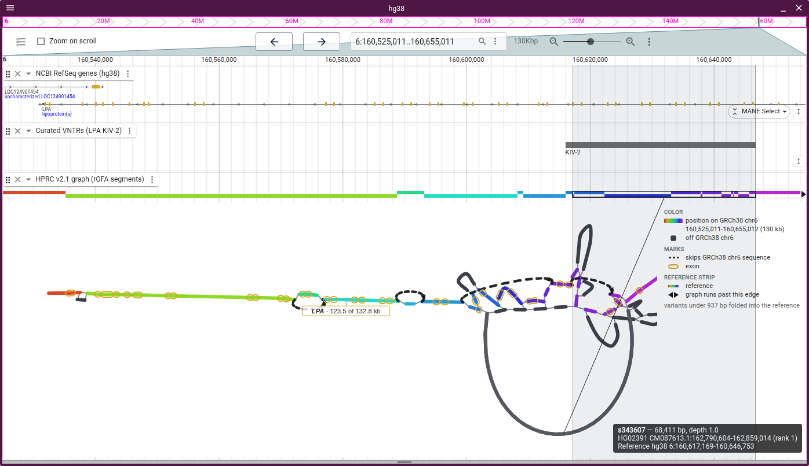
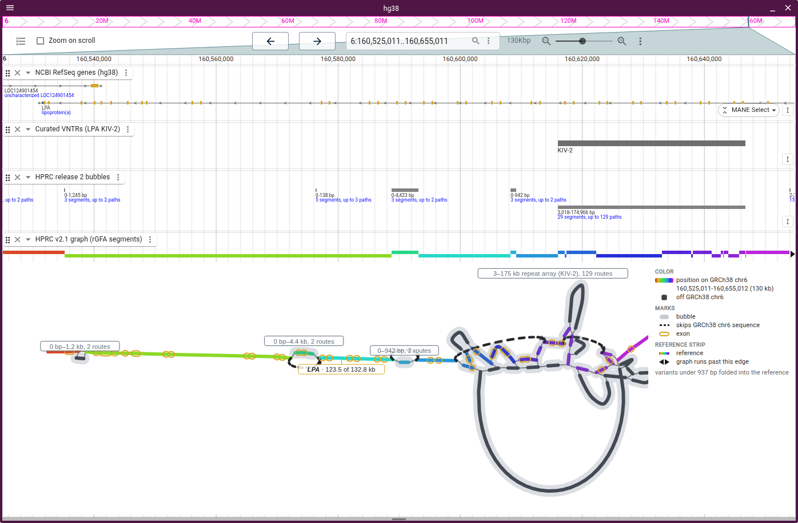
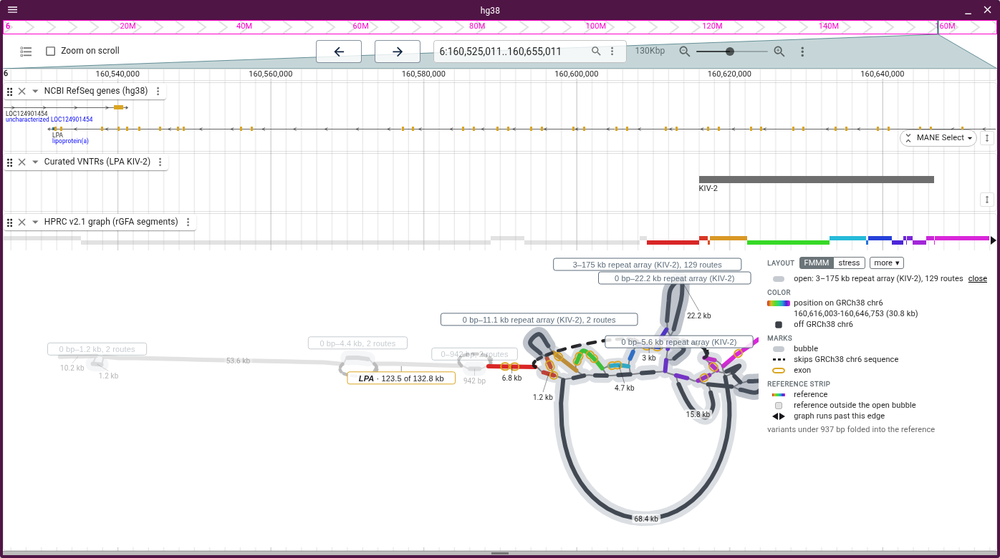
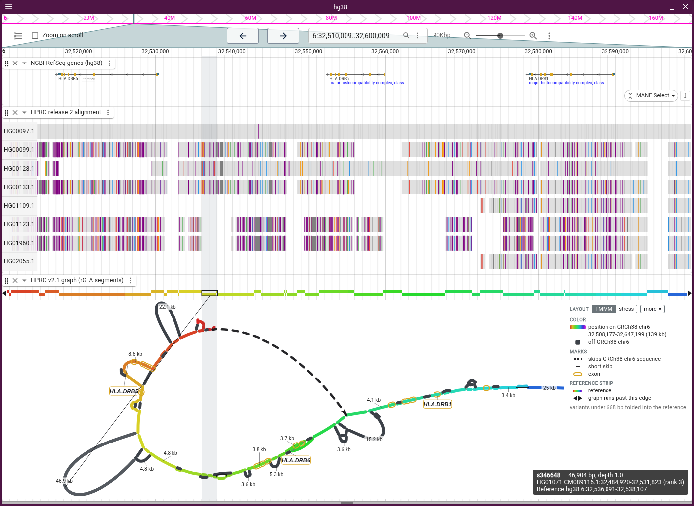

# Layouts, bubbles and genes

| Layout                | x axis                                       | Needs                        |
| --------------------- | -------------------------------------------- | ---------------------------- |
| Force-directed        | graph shape, seeded along the reference      | any graph                    |
| Ordered               | reference order, so a bubble reads as a lens | rGFA or reference path       |
| Anchored              | reference bp, a row per stable rank          | rGFA or reference path       |
| Sample rows           | reference bp, a row per assembly             | W or P lines                 |
| Walk rows             | each walk's own bp, a bar per haplotype      | W or P lines                 |
| Tube map              | node order, widths log-scaled                | W or P lines                 |
| Tube map on reference | reference bp                                 | W or P lines and a reference |

- **Force-directed** uses Bandage's OGDF FMMM engine, in a graph track and a
  graph view alike. It lays out unbranching runs, so a 15,000-node cut draws in
  a few seconds. The stress engine instead holds the reference straight along x,
  so zooming in crops one picture. The Layout menu and the settings dialog
  switch engines
- In a linear view's track, a force-directed drawing is cut on a fixed grid and
  held while the view stays inside its cut, so a pan slides the drawing with the
  ruler and lays nothing out again until the view crosses to the next cut. The
  track keeps its last four cuts, so a pan back draws one again without a fetch.
  Where a cut is over the node limit the window is cut alone, and in a flipped
  view every pan cuts the window alone
  - A pinch that starts on a node zooms the drawing itself. The drawing then
    stops following the view until the next cut lands
  - A dragged node keeps its place while its cut is one of the four kept. Once
    the track drops that cut, a pan back lays it out afresh and the node returns
    to where the layout puts it
- **Walk rows** make a repeat expansion read as bar length. See
  [haplotypes.md](haplotypes.md#walk-rows)
- **Tube maps** follow
  [sequenceTubeMap](https://github.com/vgteam/sequenceTubeMap). See
  [tube-maps.md](tube-maps.md)
- **Show › Show node lengths** (off by default) writes each node's length on it
  where the node is long enough to hold it. A "nodes not shown" placeholder
  states its length either way. Placeholders on one spot share one length, the
  longest, whether or not their loops could hold it, two lengths that read the
  same stand at least a line apart, and the key counts the rest as unlabelled,
  as it counts a length with no room on the pane
- The key lists what the pane shows, the drawing under the key included, and
  nothing else: an exon, a node thickness or a mark that lies on the cut past
  the window is not keyed, and the last line counts the sites left out where the
  pane shows. A pan or zoom never moves the pane's height; a key that lists more
  than it had room for when the drawing was laid out scrolls
- **Show › Show links that skip reference** (on by default) draws each link that
  skips reference sequence, with no words, dashed. Where the span it jumps on
  screen is short it arches low between its ends; in a graph with walks, one
  too short on screen to arch is left out and the key's last line counts it,
  and in a graph without walks a short one is a plain line with no arrowhead
- **Show › Show small sites** (off by default) draws every node, and every skip
  long enough on screen to arch, at any zoom. Off, a site too small to see at the current zoom, a stretch off the
  reference or a skip only a few pixels long, is left out: the reference runs
  straight through it, the key's last line counts the nodes and skips left out
  and the bp they are under, and zooming in draws each site again

## Reference strip

In a linear view's track, a force-directed or ordered drawing has no bp axis. A
strip along the top draws each reference segment at its bp, in its node's
colour.

- Touching segments alternate between two tiers while 12 px or more wide on
  average. A base-level cut draws as one band
- Hovering a node or bubble name boxes its reference span on the strip and draws
  a leader to the node. An allele's span runs between its flanks
- While haplotypes are lifted, the strip gives each walk a row, pale where the
  walk skips a segment. A deletion is a pale gap
- A triangle at either end marks where the graph draws reference past that edge
- **Show › Show reference strip** turns it off

Hovering HG02391's 68 kb segment boxes its span on the strip, and the linear
view bands the same bp across the curated KIV-2 array:

A linear view of a haplotype's own assembly, such as a synteny row or one opened
from the node menu, bands where that haplotype carries the hovered node on its
own contig. Each walk through the node gives one band, so a node a haplotype
walks twice bands twice.

## Bubbles

A bubble is a place where paths split and rejoin, such as a SNP, an indel or a
repeat array. The node layouts can mark each one.

- **Sources:** `<prefix>.bubbles.bed.gz` beside an rGFA index holds
  `gfatools bubble` records, and `gfa-to-tabix bubbles` writes the same file
  from a plain GFA's snarl VCF. A GBZ cut, a pggb file or an open bubble gets
  bubbles derived from the ordered layout
- **Show › Show bubble halos** (off by default) draws each structural variant as
  a halo along its nodes, all in one colour, labelled by its route lengths and
  route count, never by an event against the reference
- A variant under 50 bp is a tick above its nodes, named on hover
- Clicking a label opens the bubble in place: its nodes get the full colour ramp
  and the rest greys. Bubbles inside get labels, so a superbubble opens level by
  level. Click the label or the legend's **close** to shut it
- A linear view's bubbles track and a `vg deconstruct` VCF (IDs like
  `>1234>1240`) name whole bubbles: hovering a record rings its bubble in the
  graph, halos on or off, and clicking the record opens it

The HPRC bubbles track draws the same records at their bp. The 3,018–174,966 bp
record, 29 segments and up to 129 paths, is the KIV-2 halo:

Opened, the KIV-2 array takes the whole ramp:

## Genes

The view draws each of the session's exons as a goldenrod outline around the
stretch of node it sits on, and pins the gene's name under its midpoint.

- The view draws exons on the backbone's nodes and on a coarse tier's bubble
  nodes
- A node off the reference on an rGFA graph gets its own haplotype's genes when
  the session loads that haplotype as an assembly with a gene track (a CAT
  track, say). The name reads `LPA · HG02391#1`. The first 40 such contigs in
  the cut are read
- A name never covers a node its gene is not on, so it moves a row or is left
  off
- The label of a gene partly in the cut gives how much of it the cut holds, each
  amount in its own unit: `LPA · 35 of 132.8 kb`, `PRKN · 8.2 kb of 1.4 Mb`
- A gene whose midpoint is off the pane or under the key is named at the nearest
  point of it the pane shows. A gene the pane shows none of is not named
- Where the reference walks a collapsed repeat's copies over one loop of nodes,
  the loop is named for the copy the reference passes first. The other copies
  keep their exons and their hover, with no name
- In a graph genome view, a tube map draws genes in rows above the tubes. In a
  linear view the gene track shows them ([tube-maps.md](tube-maps.md#axes))
- Where the linear view shows genes as a lane, the graph names only what the
  lane draws
- Records spanning a whole sequence (RefSeq's `region`) and records with no
  `gene_name`, `Name`, `gene` or `gene_id` get no name

In MHC class II, HLA-DRB5, HLA-DRB6 and HLA-DRB1 sit over their exons. Hovering
HG01071's 46.9 kb allele bands the stretch of GRCh38 it replaces between
HLA-DRB5 and HLA-DRB6, and the alignment rows above show which haplotypes differ
from GRCh38 along it:

### Which assembly

A backbone names a sample by PanSN (`GRCh38#0#chr6`), not an assembly. The view
draws genes on a backbone only for the assembly it read them for.

- A walk names the cut's assembly when its sample or haplotype is the assembly's
  name, a session alias, a prefix that `assemblyNameToPanSN` maps, or a
  reference's well-known sample (hg38 is GRCh38, hs1 is CHM13)
- A path graph draws x along the first walk, which for gbz-base is the adapter's
  `referenceSample`, the database's only reference sample, or vg's `_gbwt_ref`.
  The track config puts that walk on the cut's assembly, whatever its name
- After "Draw x along" picks another walk, genes stay only where that walk names
  their assembly
- A sample-level name (`HG002`) names no haplotype of a diploid, and a bare
  (`chr6`) or generic name names none

## Export

- **Export SVG** in the graph genome view saves the drawing, keys and panels
- In a linear view, the view's **Export SVG** draws the track as shown
