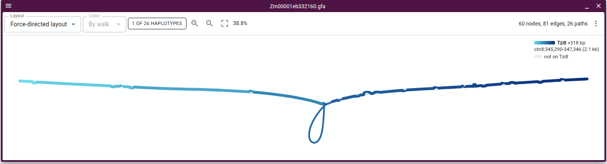
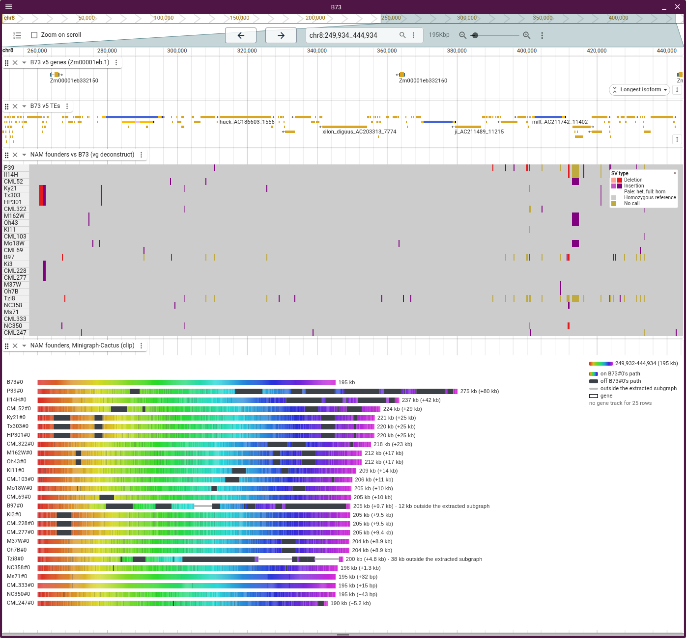
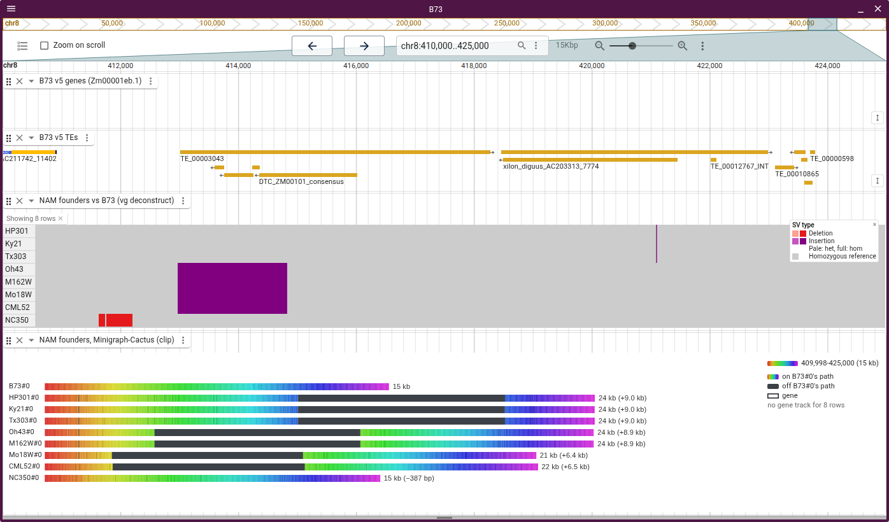
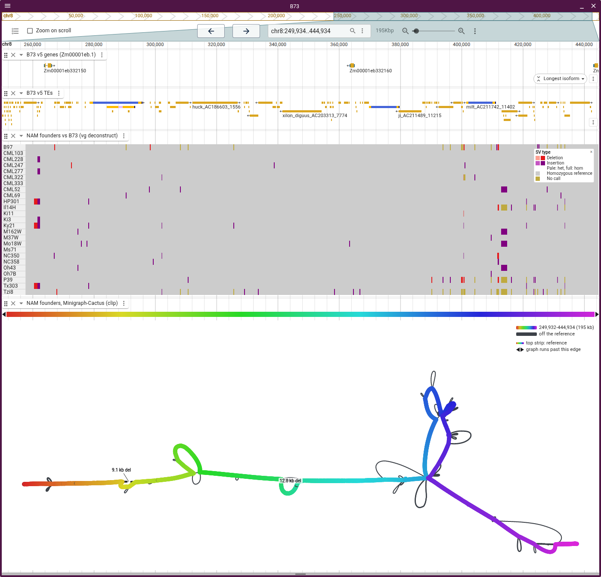

# Maize NAM founders

The graphs on this page hold B73 and the 25 NAM founders, from MaizeGDB's
pangenome
([bioRxiv 2026.08.31.748368](https://doi.org/10.64898/2026.08.31.748368)).

## MaizeGDB's graph of one gene

The graph genome view opens the GFA their
[Pangenome Viewer](https://pangenome-viewer.maizegdb.org/) serves for
_Zm00001eb332160_. Tzi8 takes the 316 bp loop the other founders skip, the
insertion the paper's Fig. 6 circles.

Open it as
[force-directed with Tzi8 lifted](https://jbrowse.org/code/jb2/main/?config=https://raw.githubusercontent.com/GMOD/jbrowse-plugin-graphgenomeviewer/main/docs/maize/config.json&session=spec-%7B%22views%22%3A%5B%7B%22type%22%3A%22GraphGenomeView%22%2C%22layoutMode%22%3A%22force%22%2C%22referencePath%22%3A%22B73%22%2C%22gfaLocation%22%3A%7B%22uri%22%3A%22https%3A//jbrowse.org/demos/maize_nam/Zm00001eb332160.gfa%22%2C%22locationType%22%3A%22UriLocation%22%7D%2C%22walkLayers%22%3A%5B%7B%22walk%22%3A%22Tzi8%230%23chr8%235150%5B340140-342196%5D%22%7D%5D%7D%5D%7D),
[walk rows](https://jbrowse.org/code/jb2/main/?config=https://raw.githubusercontent.com/GMOD/jbrowse-plugin-graphgenomeviewer/main/docs/maize/config.json&session=spec-%7B%22views%22%3A%5B%7B%22type%22%3A%22GraphGenomeView%22%2C%22layoutMode%22%3A%22walkrows%22%2C%22referencePath%22%3A%22B73%22%2C%22gfaLocation%22%3A%7B%22uri%22%3A%22https%3A//jbrowse.org/demos/maize_nam/Zm00001eb332160.gfa%22%2C%22locationType%22%3A%22UriLocation%22%7D%7D%5D%7D),
[a tube map on B73](https://jbrowse.org/code/jb2/main/?config=https://raw.githubusercontent.com/GMOD/jbrowse-plugin-graphgenomeviewer/main/docs/maize/config.json&session=spec-%7B%22views%22%3A%5B%7B%22type%22%3A%22GraphGenomeView%22%2C%22layoutMode%22%3A%22tubemapref%22%2C%22referencePath%22%3A%22B73%22%2C%22gfaLocation%22%3A%7B%22uri%22%3A%22https%3A//jbrowse.org/demos/maize_nam/Zm00001eb332160.gfa%22%2C%22locationType%22%3A%22UriLocation%22%7D%7D%5D%7D)
or
[a tube per route](https://jbrowse.org/code/jb2/main/?config=https://raw.githubusercontent.com/GMOD/jbrowse-plugin-graphgenomeviewer/main/docs/maize/config.json&session=spec-%7B%22views%22%3A%5B%7B%22type%22%3A%22GraphGenomeView%22%2C%22layoutMode%22%3A%22tubemap%22%2C%22referencePath%22%3A%22B73%22%2C%22gfaLocation%22%3A%7B%22uri%22%3A%22https%3A//jbrowse.org/demos/maize_nam/Zm00001eb332160.gfa%22%2C%22locationType%22%3A%22UriLocation%22%7D%2C%22tubeMapRoutes%22%3A%22bundled%22%7D%5D%7D).
The GFA is a copy of MaizeGDB's, at
https://jbrowse.org/demos/maize_nam/Zm00001eb332160.gfa.

## A Minigraph-Cactus graph of chr8:1-450 kb

We built B73 and the founders over the first 450 kb of chr8 with
`scripts/build_maize_nam_graph.sh`, the recipe the paper uses chromosome-wide.
The figures draw the graph as a track under B73's genes and TEs and a variant
track:

- **The variant track** puts each founder's insertions and deletions at B73's
  bp, one row per founder. `vg deconstruct` writes it from the graph, and the
  build script splits each site into one record per allele.
- **The walk rows** show each founder's walk at its own length, the sequence off
  B73's path in charcoal. The variant track lists its rows in the same order.

The variant track shows where in B73 a founder's walk leaves B73's path and
which founders share each departure. The walk rows show how much sequence each
departure adds:

[Open](https://jbrowse.org/code/jb2/main/?config=https://raw.githubusercontent.com/GMOD/jbrowse-plugin-graphgenomeviewer/main/docs/maize/config.json&session=spec-%7B%22views%22%3A%5B%7B%22type%22%3A%22LinearGenomeView%22%2C%22assembly%22%3A%22B73%22%2C%22loc%22%3A%22chr8%3A250%2C000-445%2C000%22%2C%22tracks%22%3A%5B%7B%22trackId%22%3A%22b73_genes%22%2C%22type%22%3A%22LinearBasicDisplay%22%2C%22height%22%3A50%7D%2C%7B%22trackId%22%3A%22b73_te%22%2C%22type%22%3A%22LinearBasicDisplay%22%2C%22height%22%3A60%7D%2C%7B%22trackId%22%3A%22maize_nam_variants%22%2C%22type%22%3A%22LinearMultiSampleVariantDisplay%22%2C%22filter%22%3A%5B%22jexl%3AsvType%28feature%29%20%3D%3D%20%27INS%27%20%7C%7C%20svType%28feature%29%20%3D%3D%20%27DEL%27%22%5D%2C%22height%22%3A350%7D%2C%7B%22trackId%22%3A%22maize_nam_clip%22%2C%22type%22%3A%22LinearGraphDisplay%22%2C%22layoutMode%22%3A%22walkrows%22%2C%22height%22%3A560%7D%5D%7D%5D%7D)

The figures' windows end before 450 kb, where B73's slice ends. Each founder's
slice runs on past that point, so `vg deconstruct` reads the founder sequence
beyond B73's end as one insertion in nearly every row.

## Shared insertions

Over chr8:410-425 kb, HP301, Ky21 and Tx303 carry one insertion at 421 kb. Oh43
and M162W carry a longer allele at 413 kb, and Mo18W and CML52 a shorter one
there. NC350 carries neither:

[Open](https://jbrowse.org/code/jb2/main/?config=https://raw.githubusercontent.com/GMOD/jbrowse-plugin-graphgenomeviewer/main/docs/maize/config.json&session=spec-%7B%22views%22%3A%5B%7B%22type%22%3A%22LinearGenomeView%22%2C%22assembly%22%3A%22B73%22%2C%22loc%22%3A%22chr8%3A410%2C000-425%2C000%22%2C%22tracks%22%3A%5B%7B%22trackId%22%3A%22b73_genes%22%2C%22type%22%3A%22LinearBasicDisplay%22%2C%22height%22%3A50%7D%2C%7B%22trackId%22%3A%22b73_te%22%2C%22type%22%3A%22LinearBasicDisplay%22%2C%22height%22%3A60%7D%2C%7B%22trackId%22%3A%22maize_nam_variants%22%2C%22type%22%3A%22LinearMultiSampleVariantDisplay%22%2C%22filter%22%3A%5B%22jexl%3AsvType%28feature%29%20%3D%3D%20%27INS%27%20%7C%7C%20svType%28feature%29%20%3D%3D%20%27DEL%27%22%5D%2C%22rows%22%3A%7B%22kept%22%3A%5B%22HP301%22%2C%22Ky21%22%2C%22Tx303%22%2C%22Oh43%22%2C%22M162W%22%2C%22Mo18W%22%2C%22CML52%22%2C%22NC350%22%5D%2C%22sort%22%3A%5B%22HP301%22%2C%22Ky21%22%2C%22Tx303%22%2C%22Oh43%22%2C%22M162W%22%2C%22Mo18W%22%2C%22CML52%22%2C%22NC350%22%5D%7D%2C%22height%22%3A180%7D%2C%7B%22trackId%22%3A%22maize_nam_clip%22%2C%22type%22%3A%22LinearGraphDisplay%22%2C%22layoutMode%22%3A%22walkrows%22%2C%22rows%22%3A%7B%22kept%22%3A%5B%22B73%22%2C%22HP301%22%2C%22Ky21%22%2C%22Tx303%22%2C%22Oh43%22%2C%22M162W%22%2C%22Mo18W%22%2C%22CML52%22%2C%22NC350%22%5D%7D%2C%22height%22%3A250%7D%5D%7D%5D%7D)

The carriers' own TE annotations from MaizeGDB mark the inserted sequence as
transposons. Oh43 and M162W's allele at 413 kb contains an opie retrotransposon
where Mo18W and CML52's contains a fourf, so the two alleles at that site come
from separate insertions. `scripts/maize_insertion_tes.sh` prints the TEs over
every insertion of 1 kb or more, read off the build's VCF and each carrier's
annotation.

## The graph force-directed

A force-directed layout of the same window draws the sequence off B73's path as
charcoal loops. The variant track above it shows which founders carry each loop:

[Open](https://jbrowse.org/code/jb2/main/?config=https://raw.githubusercontent.com/GMOD/jbrowse-plugin-graphgenomeviewer/main/docs/maize/config.json&session=spec-%7B%22views%22%3A%5B%7B%22type%22%3A%22LinearGenomeView%22%2C%22assembly%22%3A%22B73%22%2C%22loc%22%3A%22chr8%3A250%2C000-445%2C000%22%2C%22tracks%22%3A%5B%7B%22trackId%22%3A%22b73_genes%22%2C%22type%22%3A%22LinearBasicDisplay%22%2C%22height%22%3A50%7D%2C%7B%22trackId%22%3A%22b73_te%22%2C%22type%22%3A%22LinearBasicDisplay%22%2C%22height%22%3A60%7D%2C%7B%22trackId%22%3A%22maize_nam_variants%22%2C%22type%22%3A%22LinearMultiSampleVariantDisplay%22%2C%22filter%22%3A%5B%22jexl%3AsvType%28feature%29%20%3D%3D%20%27INS%27%20%7C%7C%20svType%28feature%29%20%3D%3D%20%27DEL%27%22%5D%2C%22height%22%3A350%7D%2C%7B%22trackId%22%3A%22maize_nam_clip%22%2C%22type%22%3A%22LinearGraphDisplay%22%2C%22layoutMode%22%3A%22force%22%2C%22layoutEngine%22%3A%22fmmm%22%2C%22height%22%3A600%7D%5D%7D%5D%7D)
