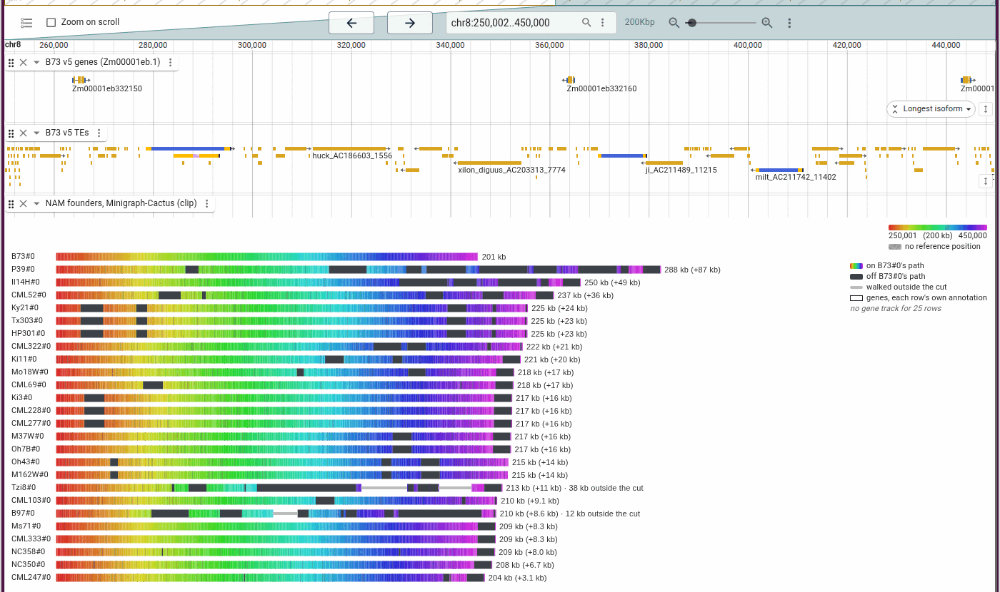
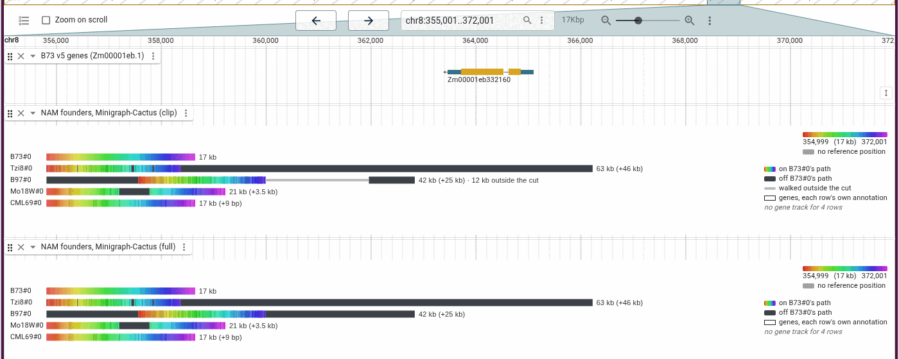
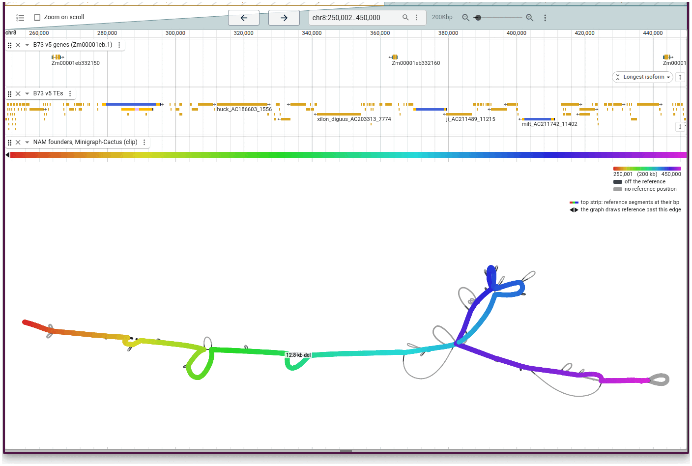

# Maize NAM founders

B73 and the 25 NAM founders, from MaizeGDB's pangenome
([bioRxiv 2026.08.31.748368](https://doi.org/10.64898/2026.08.31.748368)).

## MaizeGDB's graph of one gene

The graph genome view opens the GFA their
[Pangenome Viewer](https://pangenome-viewer.maizegdb.org/) serves for
_Zm00001eb332160_. Tzi8 takes the 316 bp loop the other founders skip, the
insertion the paper's Fig. 6 circles.

Open it as
[force-directed with Tzi8 lifted](https://jbrowse.org/code/jb2/main/?config=https://raw.githubusercontent.com/GMOD/jbrowse-plugin-graphgenomeviewer/main/docs/maize/config.json&session=spec-%7B%22views%22%3A%5B%7B%22type%22%3A%22GraphGenomeView%22%2C%22layoutMode%22%3A%22force%22%2C%22referencePath%22%3A%22B73%22%2C%22gfaLocation%22%3A%7B%22uri%22%3A%22https%3A//jbrowse.org/demos/maize_nam/Zm00001eb332160.gfa%22%2C%22locationType%22%3A%22UriLocation%22%7D%2C%22walkLayers%22%3A%5B%7B%22walk%22%3A%22Tzi8%230%23chr8%235150%5B340140-342196%5D%22%7D%5D%7D%5D%7D),
[walk rows](https://jbrowse.org/code/jb2/main/?config=https://raw.githubusercontent.com/GMOD/jbrowse-plugin-graphgenomeviewer/main/docs/maize/config.json&session=spec-%7B%22views%22%3A%5B%7B%22type%22%3A%22GraphGenomeView%22%2C%22layoutMode%22%3A%22walkrows%22%2C%22referencePath%22%3A%22B73%22%2C%22gfaLocation%22%3A%7B%22uri%22%3A%22https%3A//jbrowse.org/demos/maize_nam/Zm00001eb332160.gfa%22%2C%22locationType%22%3A%22UriLocation%22%7D%7D%5D%7D),
[a tube map on B73](https://jbrowse.org/code/jb2/main/?config=https://raw.githubusercontent.com/GMOD/jbrowse-plugin-graphgenomeviewer/main/docs/maize/config.json&session=spec-%7B%22views%22%3A%5B%7B%22type%22%3A%22GraphGenomeView%22%2C%22layoutMode%22%3A%22tubemapref%22%2C%22referencePath%22%3A%22B73%22%2C%22gfaLocation%22%3A%7B%22uri%22%3A%22https%3A//jbrowse.org/demos/maize_nam/Zm00001eb332160.gfa%22%2C%22locationType%22%3A%22UriLocation%22%7D%7D%5D%7D)
or
[a tube per route](https://jbrowse.org/code/jb2/main/?config=https://raw.githubusercontent.com/GMOD/jbrowse-plugin-graphgenomeviewer/main/docs/maize/config.json&session=spec-%7B%22views%22%3A%5B%7B%22type%22%3A%22GraphGenomeView%22%2C%22layoutMode%22%3A%22tubemap%22%2C%22referencePath%22%3A%22B73%22%2C%22gfaLocation%22%3A%7B%22uri%22%3A%22https%3A//jbrowse.org/demos/maize_nam/Zm00001eb332160.gfa%22%2C%22locationType%22%3A%22UriLocation%22%7D%2C%22tubeMapRoutes%22%3A%22bundled%22%7D%5D%7D).
The GFA is a copy of MaizeGDB's, at
https://jbrowse.org/demos/maize_nam/Zm00001eb332160.gfa.

## A Minigraph-Cactus graph of chr8:1-450 kb

We built B73 and the founders over the first 450 kb of chr8 with
`scripts/build_maize_nam_graph.sh`, the recipe the paper uses chromosome-wide,
and drew it as a track under B73's genes and TEs.

Over 200 kb, every founder's walk is longer than B73's, by 3 kb (CML247) to 87
kb (P39), mostly through sequence off B73's path:

[Open](https://jbrowse.org/code/jb2/main/?config=https://raw.githubusercontent.com/GMOD/jbrowse-plugin-graphgenomeviewer/main/docs/maize/config.json&session=spec-%7B%22views%22%3A%5B%7B%22type%22%3A%22LinearGenomeView%22%2C%22assembly%22%3A%22B73%22%2C%22loc%22%3A%22chr8%3A250%2C000-450%2C000%22%2C%22tracks%22%3A%5B%7B%22trackId%22%3A%22b73_genes%22%2C%22type%22%3A%22LinearBasicDisplay%22%2C%22height%22%3A60%7D%2C%7B%22trackId%22%3A%22b73_te%22%2C%22type%22%3A%22LinearBasicDisplay%22%2C%22height%22%3A60%7D%2C%7B%22trackId%22%3A%22maize_nam_clip%22%2C%22type%22%3A%22LinearGraphDisplay%22%2C%22layoutMode%22%3A%22walkrows%22%2C%22height%22%3A560%7D%5D%7D%5D%7D)

At _Zm00001eb332160_, B97's walk leaves the window for 12 kb in Cactus's clip
graph and stays inside it in the full graph:

[Open](https://jbrowse.org/code/jb2/main/?config=https://raw.githubusercontent.com/GMOD/jbrowse-plugin-graphgenomeviewer/main/docs/maize/config.json&session=spec-%7B%22views%22%3A%5B%7B%22type%22%3A%22LinearGenomeView%22%2C%22assembly%22%3A%22B73%22%2C%22loc%22%3A%22chr8%3A355%2C000-372%2C000%22%2C%22tracks%22%3A%5B%7B%22trackId%22%3A%22b73_genes%22%2C%22type%22%3A%22LinearBasicDisplay%22%2C%22height%22%3A50%7D%2C%7B%22trackId%22%3A%22maize_nam_clip%22%2C%22type%22%3A%22LinearGraphDisplay%22%2C%22layoutMode%22%3A%22walkrows%22%2C%22height%22%3A170%2C%22rows%22%3A%7B%22kept%22%3A%5B%22B73%22%2C%22Tzi8%22%2C%22B97%22%2C%22Mo18W%22%2C%22CML69%22%5D%7D%7D%2C%7B%22trackId%22%3A%22maize_nam_full%22%2C%22type%22%3A%22LinearGraphDisplay%22%2C%22layoutMode%22%3A%22walkrows%22%2C%22height%22%3A170%2C%22rows%22%3A%7B%22kept%22%3A%5B%22B73%22%2C%22Tzi8%22%2C%22B97%22%2C%22Mo18W%22%2C%22CML69%22%5D%7D%7D%5D%7D%5D%7D)

A force-directed layout of chr8:250-450 kb draws the sequence with no B73
position as grey loops:

[Open](https://jbrowse.org/code/jb2/main/?config=https://raw.githubusercontent.com/GMOD/jbrowse-plugin-graphgenomeviewer/main/docs/maize/config.json&session=spec-%7B%22views%22%3A%5B%7B%22type%22%3A%22LinearGenomeView%22%2C%22assembly%22%3A%22B73%22%2C%22loc%22%3A%22chr8%3A250%2C000-450%2C000%22%2C%22tracks%22%3A%5B%7B%22trackId%22%3A%22b73_genes%22%2C%22type%22%3A%22LinearBasicDisplay%22%2C%22height%22%3A60%7D%2C%7B%22trackId%22%3A%22b73_te%22%2C%22type%22%3A%22LinearBasicDisplay%22%2C%22height%22%3A60%7D%2C%7B%22trackId%22%3A%22maize_nam_clip%22%2C%22type%22%3A%22LinearGraphDisplay%22%2C%22layoutMode%22%3A%22force%22%2C%22layoutEngine%22%3A%22fmmm%22%2C%22height%22%3A600%7D%5D%7D%5D%7D)
