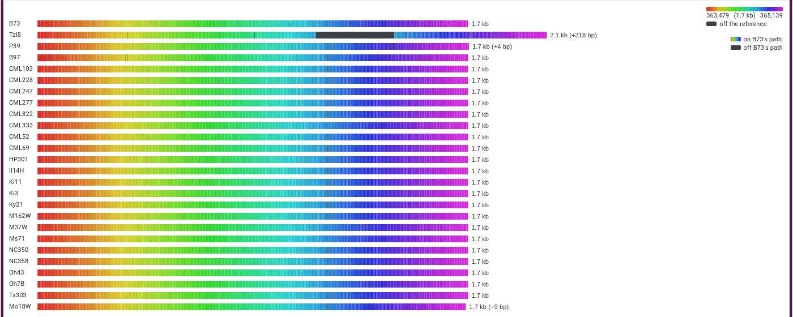

# Maize NAM founders

MaizeGDB's graph of B73 and the 25 NAM founders at _Zm00001eb332160_, from their
[Pangenome Viewer](https://pangenome-viewer.maizegdb.org/)
([bioRxiv 2026.08.31.748368](https://doi.org/10.64898/2026.08.31.748368)), in
the graph genome view. Tzi8's walk runs 318 bp longer than B73's, through
sequence off the reference: the insertion the paper's Fig. 6 circles.

- [Walk rows](https://jbrowse.org/code/jb2/main/?config=https://raw.githubusercontent.com/GMOD/jbrowse-plugin-graphgenomeviewer/main/docs/maize/config.json&session=spec-%7B%22views%22%3A%5B%7B%22type%22%3A%22GraphGenomeView%22%2C%22layoutMode%22%3A%22walkrows%22%2C%22referencePath%22%3A%22B73%22%2C%22gfaLocation%22%3A%7B%22uri%22%3A%22https%3A//jbrowse.org/demos/maize_nam/Zm00001eb332160.gfa%22%2C%22locationType%22%3A%22UriLocation%22%7D%7D%5D%7D)
- [Tube map on B73](https://jbrowse.org/code/jb2/main/?config=https://raw.githubusercontent.com/GMOD/jbrowse-plugin-graphgenomeviewer/main/docs/maize/config.json&session=spec-%7B%22views%22%3A%5B%7B%22type%22%3A%22GraphGenomeView%22%2C%22layoutMode%22%3A%22tubemapref%22%2C%22referencePath%22%3A%22B73%22%2C%22gfaLocation%22%3A%7B%22uri%22%3A%22https%3A//jbrowse.org/demos/maize_nam/Zm00001eb332160.gfa%22%2C%22locationType%22%3A%22UriLocation%22%7D%7D%5D%7D)
- [Force-directed](https://jbrowse.org/code/jb2/main/?config=https://raw.githubusercontent.com/GMOD/jbrowse-plugin-graphgenomeviewer/main/docs/maize/config.json&session=spec-%7B%22views%22%3A%5B%7B%22type%22%3A%22GraphGenomeView%22%2C%22layoutMode%22%3A%22force%22%2C%22referencePath%22%3A%22B73%22%2C%22gfaLocation%22%3A%7B%22uri%22%3A%22https%3A//jbrowse.org/demos/maize_nam/Zm00001eb332160.gfa%22%2C%22locationType%22%3A%22UriLocation%22%7D%7D%5D%7D)

The GFA is a copy of MaizeGDB's, at
https://jbrowse.org/demos/maize_nam/Zm00001eb332160.gfa.
