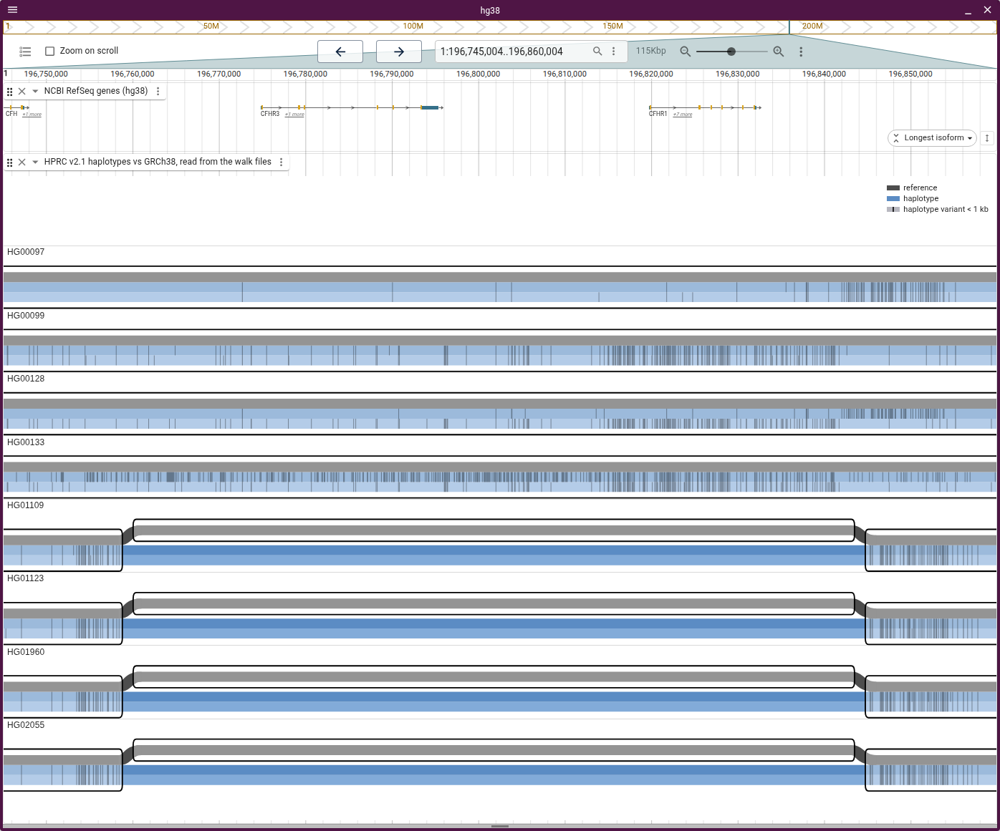
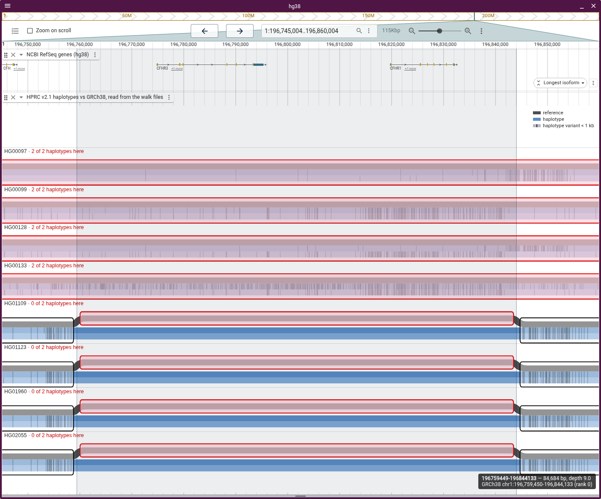
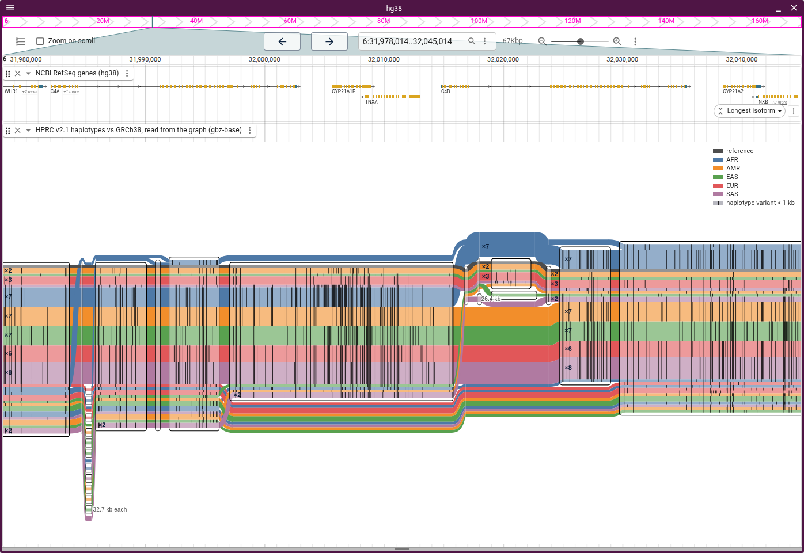
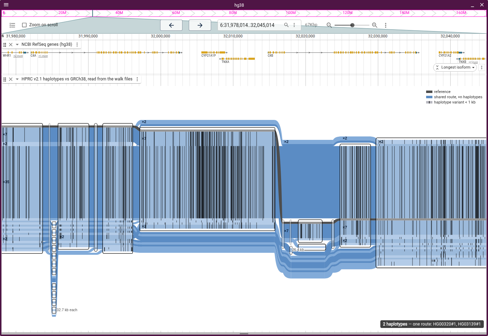
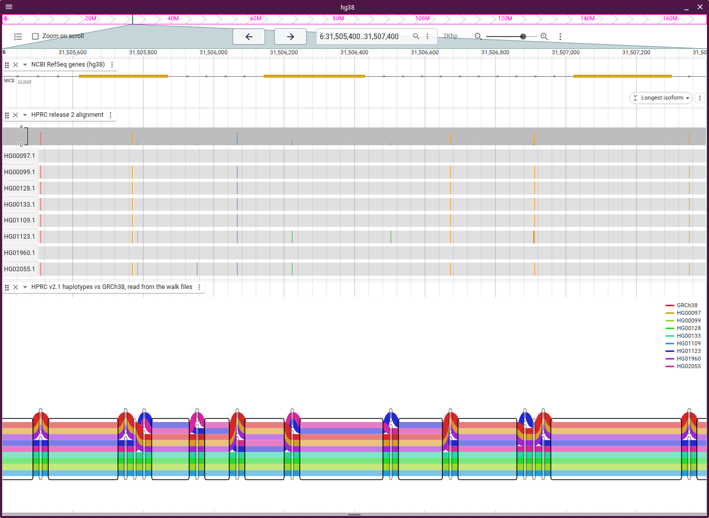
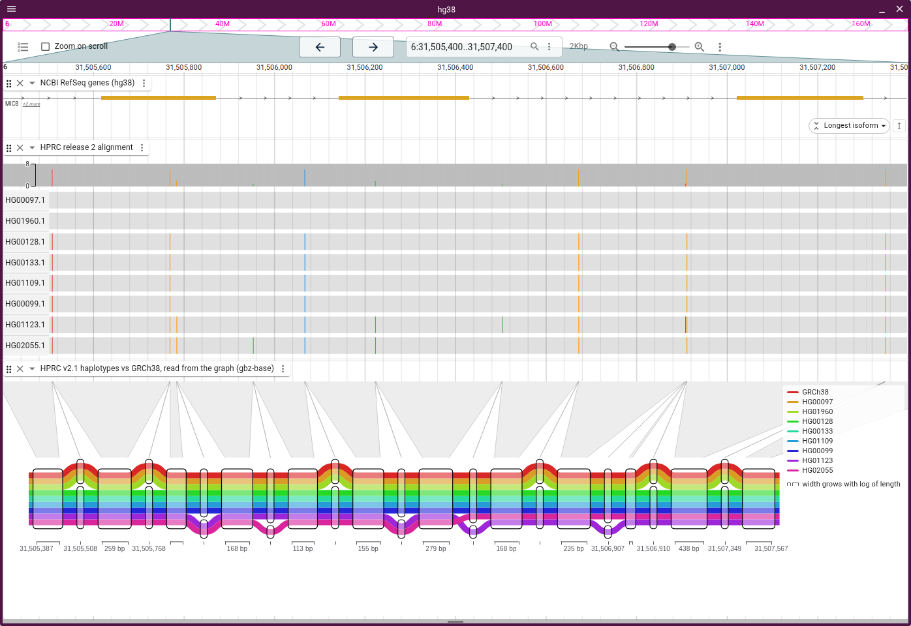
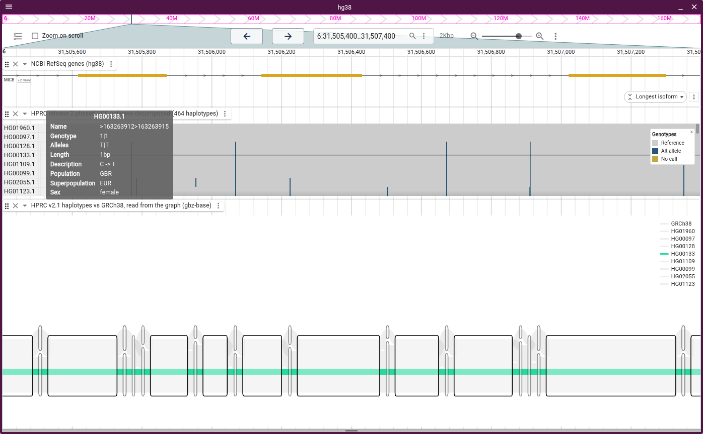
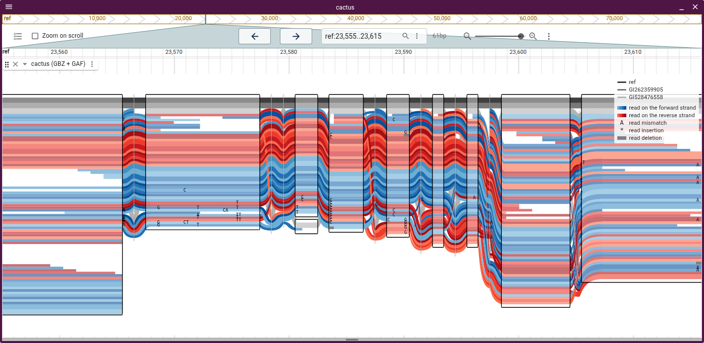

# Tube maps

A tube map draws every path as a coloured tube through boxed nodes, like a metro
map. `@jbrowse/tubemap-core` lays out sequenceTubeMap's tubes from the P and W
lines, reference first. A reverse-strand walk runs through its boxes right to
left.

Pick **Tube map** or **Tube map on reference** from the layout menu
([layouts.md](layouts.md)).

## Axes

- **Own axis:** columns follow node order. A box is as wide as the log of its
  length (2 bp is 8 px, 100 bp 56, 1 kb 84, 22 kb 121), and the legend says no
  box is to scale. A cut too long for 5 px tubes opens at its left end, so pan
  along it or zoom out
- **Reference axis:** each column sits at its bp, so boxes are to scale, with
  up to 24 px per column boundary for curves. A box off the reference draws a few
  px wide, with its length beside it when 1 kb or more
- In a linear view's track, tubes squeeze to the track's height, so drag it
  taller for wider tubes. On the own axis, a band joins each reference node's bp
  on the ruler to its box. Hovering a band picks out the node
- In a view of its own, the session's genes draw in up to four rows above the
  tubes. A linear view shows them in their own track

## Fold variants

**Fold variants** folds every variant under a size into the reference, as in
svSTM ([van den Brandt et al., EuroVis 2025](https://doi.org/10.2312/evs.20251091)).
Each walk marks its allele as a tick on its tube. MICB's 22 kb cut goes from 475
columns to 34 under 3 bp, and to one box under 50 bp. It is off by default, and
off while reads are shown.

## Panels

**Layout → Panels** (or `"facet": "sample"`, `"walk"` or a sample table column)
splits the map into small multiples, each with the reference and one group's
walks.

- **Per sample:** both haplotypes in one panel, so a genotype reads as two
  tubes, one or none through a box
- **Per haplotype:** one walk against the reference
- **By a column** of `samplesTsvLocation`, such as `superpopulation`
- On the reference axis the panels share x, and one ruler serves them all
- The reference is charcoal and haplotypes alternate two blues. Past 16 walks
  the map draws unsplit the same way
- Hovering a box lights it in every panel and bands its span in the linear view.
  Each title then counts its haplotypes through the box
- Reads are not drawn while split

An 85 kb deletion removes CFHR3 and CFHR1 on 139 of HPRC's 464 haplotypes. Eight
samples, a panel each:



Hovering the reference's CFHR3–CFHR1 box in HG01960's panel counts 2 of 2
haplotypes through it for the carriers and 0 of 2 for the rest:



## Routes and tube colour

**Layout → Routes** (or `"tubeMapRoutes"`):

- **A tube per haplotype** draws each walk
- **Grouped by route** orders tubes so identical routes stack
- **A tube per route** draws one tube as wide as the walks taking the route,
  labelled `×n`. Hovering lists the walks

**Layout → Tube color** (or `"tubeMapColorBy"`) paints tubes by a sample table
column, with the reference charcoal and a key per value.

Thirty HPRC samples over C4A and C4B, a tube per route coloured by
superpopulation. The main route, five strands wide, skips the 6.4 kb HERV-K in
C4B, and thin tubes skip or add a whole 33 kb module:



Hovering a tube lists its haplotypes:



## Reads

A gbz-base track draws GAF reads under the haplotypes in both tube map layouts:

```json
{
  "type": "GbzBaseSyntenyAdapter",
  "uri": "graph.gbz.db",
  "reads": "reads.gaf.gz",
  "assemblyNames": ["hg38"]
}
```

```console
vg giraffe -Z graph.gbz -f reads.fq -o gaf > reads.gaf
vg gamsort -G reads.gaf | bgzip > reads.gaf.gz
tabix -p gaf reads.gaf.gz
```

- Minigraph and GraphAligner GAF work if step names are the cut's segment names
  (numeric ids, or `vg giraffe --named-coordinates`)
- A tabix index needs numeric ids. Without one the plugin reads the whole file,
  up to 50 MB
- Only gbz-base tracks take reads
- Up to 5000 reads a cut. Forward reads are blue and reverse red. Haplotype tubes
  turn grey beside reads
- The cs tag's edits draw on the reads: substituted bases, `*` for an insertion,
  grey for a deletion

Eight HPRC haplotypes over MICB's exons 2–4, on the reference axis under the
RefSeq genes, with HPRC's multiple alignment between:



The MICB cut on the own axis:



Hovering a genotype cell of a callset or MAF row lifts that haplotype's walk
(MAF needs a JBrowse release after 5.0.0-beta.10):



Reads under sequenceTubeMap's cactus test graph, with mismatches lettered. A
haplotype index (`gbz-haplotype-index --from-db cactus.gbz.db
cactus.haplotype-index.db`) names the non-reference paths:


